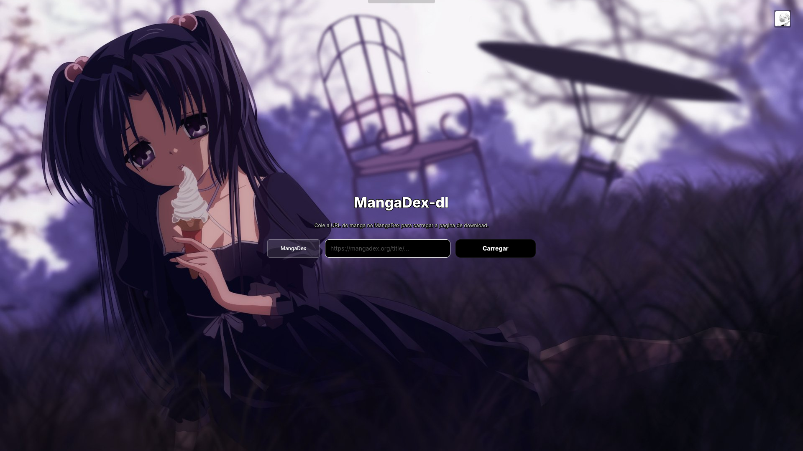
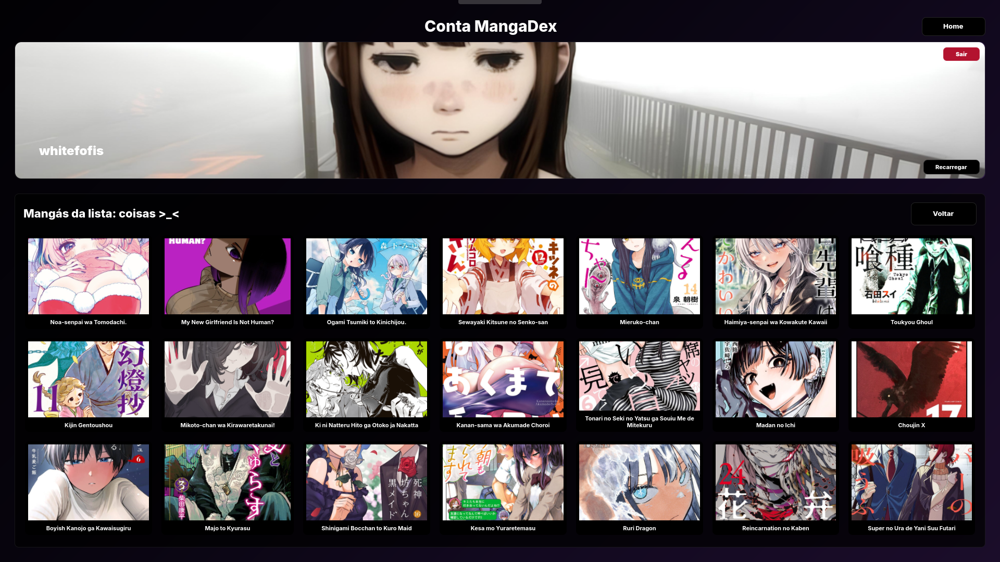
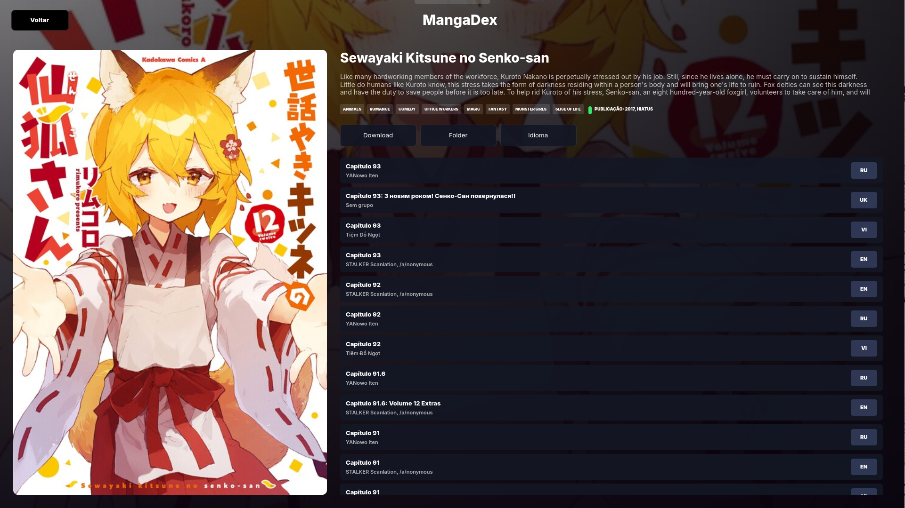
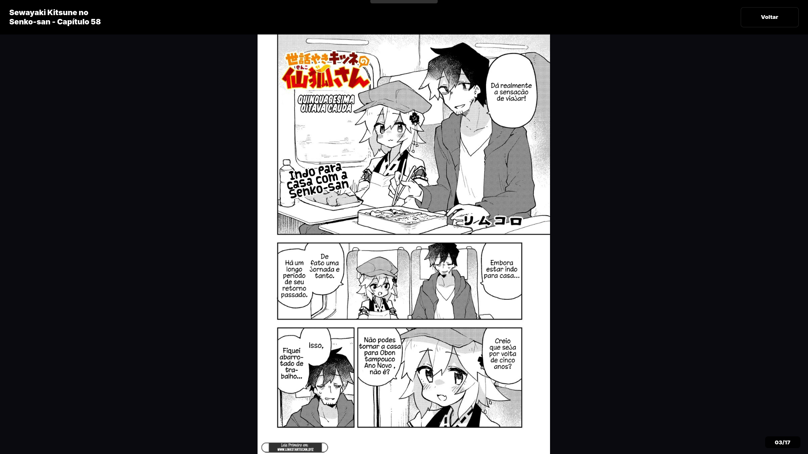

# MangaDex-dl GTK

Interface GTK 4 em Python para baixar e ler mangás do **MangaDex** e **Comick**. Inclui leitor interno, gerenciamento de MDLists, login na conta e download de capítulos via `mangadex-downloader` (MangaDex) ou download nativo (Comick).

## Screenshots

### Home


### MDLists


### Download


### Reader


## O que faz

- Busca mangás e MDLists colando a URL do MangaDex/Comick
- Lista capítulos por idioma, grupo e volume
- Leitor interno com navegação por clique (esquerda/direita) e `Esc` para voltar
- Download de capítulos selecionados (MangaDex via `mangadex-downloader`, Comick nativo)
- Login na conta MangaDex para acessar MDLists privadas
- Configura pasta padrão de download, idioma da UI e wallpaper da home

## Dependências

- Python 3.10+
- PyGObject + GTK 4 (`gir1.2-gtk-4.0`, `python3-gi`)
- `mangadex-downloader` (só para downloads do MangaDex)

---

## Instalação

### Ubuntu / Debian

```bash
# Dependências do sistema
sudo apt update
sudo apt install -y python3-gi gir1.2-gtk-4.0 gir1.2-gdkpixbuf-2.0 python3-pip pipx

# mangadex-downloader (para baixar capítulos do MangaDex)
pipx install mangadex-downloader

# Rodar o projeto
git clone https://github.com/uaitibat/mangadex-dl-gui.git
cd mangadex-dl-gui
pip install -e .          # ou apenas: python3 app.py
```

### Arch Linux

```bash
# Dependências do sistema
sudo pacman -S python-gobject gtk4 python-pipx

# mangadex-downloader (para baixar capítulos do MangaDex)
pipx install mangadex-downloader

# Rodar o projeto
git clone https://github.com/uaitibat/mangadex-dl-gui.git
cd mangadex-dl-gui
pip install -e .          # ou apenas: python3 app.py
```

> Se preferir não instalar como pacote, basta rodar `python3 app.py` direto da pasta.

---

## Como usar

1. **Configure o login** (opcional, só para MDLists): vá em Configurações → Login MangaDex e preencha Usuário, Senha, Client ID e Client Secret. Você gera essas credenciais no site do MangaDex em Conta → API Client.
2. **Cole a URL** do mangá ou da MDList na home e clique em Carregar.
3. **Escolha o idioma** dos capítulos e marque os que quer baixar.
4. **Defina a pasta de download** (ou use a padrão em `~/Downloads`).
5. **Clique em Baixar**. O progresso aparece no canto da tela.
6. **Leia** clicando em um capítulo; use clique direito/esquerdo para passar páginas e `Esc` para voltar.

## Estrutura

```
app.py             # janela principal e lógica da UI
core/              # config, cache e helpers de download
services/          # clientes de API (MangaDex, Comick) e modelos
ui/                # telas (home, resultado, leitor, conta)
assets/            # ícones, wallpaper e guia de API
fts/               # screenshots para o README
style.css          # estilos GTK
pyproject.toml     # metadados e entrypoint
config.json.example # exemplo de configuração
```

## Configuração

A config fica em `~/.config/mangadex_dl/config.json` (ou sobrescreva com a variável `MANGADEX_DL_CONFIG`). Exemplo:

```json
{
  "default_download_folder": "/home/seu_usuario/Downloads/manga",
  "ui_language": "pt-BR",
  "source": "mangadex"
}
```

O `config.json` com credenciais nunca é versionado (está no `.gitignore`).

---

Feito com PyGObject + GTK 4.

<div align="center">
  
</div>
